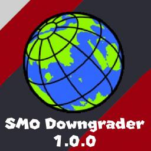

# Odyssey Downgrader V3

### CraftyBoss' Discord server: https://discord.gg/jYCueK2BqD

This fork is used to develop the downgrader v3 made by Istador & Shadow as this will
update and do some bug fixes. This fork goes off by the [checklist](https://github.com/Istador/odyssey-downgrade/issues/1) that Istador made but never
coming around finishing it back in 2022.

## The following changes for the Odyssey Downgrader are as follows:
- Merge downgrade & patch into 1 action.
- Reword the Lockpick_RCM error message to guide users better on what to do.
- Added check to see if there is enough space on the SD card.
- Added exFAT support with the downgrader
- Calculate the exefs.nsp checksums and checks to see if it matches existing ones.

### Additions to Downgrader 
- Added a custom consoleClear() so that there isn't a confusing wall of the same text.
- Runs checksums of `exefs.nsp` to see if there are any matches if not then print text that the hash is unique.

### Credits
- [Istador](https://github.com/Istador) for publishing the downgrader.
- [Shadow](https://github.com/shadowninja108) for making the code for the downgrader.

#### Why is it separate & not a fork?
- Idk how GitHub works and I felt like this is easier for me to do. 
